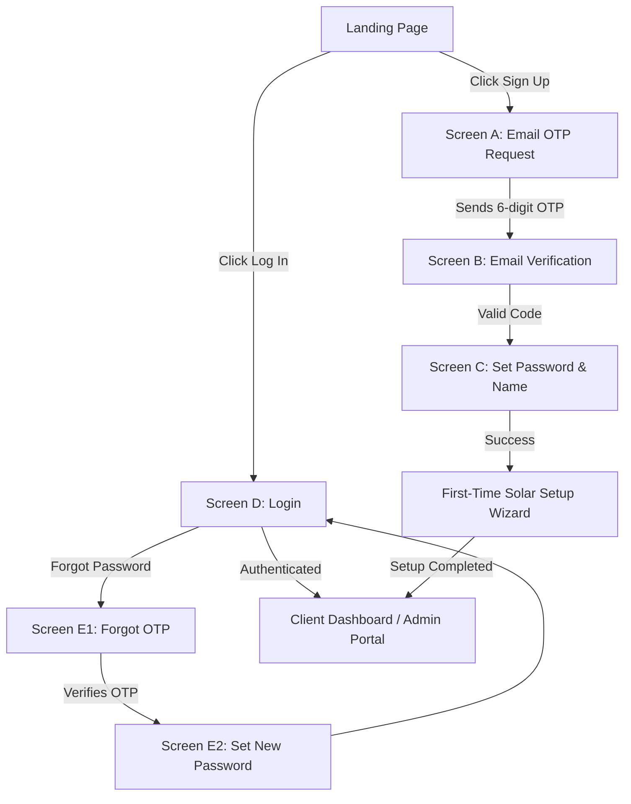

# Solar Care — Complete System Specification & Architecture Blueprint (A to Z)

> **Document Version:** 2.0.0  
> **Target Audience:** AI Models, Full-Stack Architects, and MERN Developers  
> **Purpose:** Comprehensive, turnkey technical documentation describing the entire Solar Care platform from start to finish. Any AI model or engineering team reading this document will have complete context to replicate, maintain, or extend every feature, design token, data schema, and workflow with 100% fidelity.

---

## Table of Contents
1. [Project Overview & Philosophy](#1-project-overview--philosophy)
2. [Complete Technology Stack & Dependencies](#2-complete-technology-stack--dependencies)
3. [Repository Directory & File Architecture](#3-repository-directory--file-architecture)
4. [Design System & Theme Engine (Dark & Half-Light Modes)](#4-design-system--theme-engine-dark--half-light-modes)
5. [Multilingual & Urdu RTL Typography Engine](#5-multilingual--urdu-rtl-typography-engine)
6. [Core State Management & Context Architecture](#6-core-state-management--context-architecture)
7. [The High-Conversion Landing Page](#7-the-high-conversion-landing-page)
8. [Authentication & Registration Flow (5 Screens)](#8-authentication--registration-flow-5-screens)
9. [Customer / Client Portal (Solar Cockpit)](#9-customer--client-portal-solar-cockpit)
10. [Admin Control Center (Technicians & Database Live Section)](#10-admin-control-center-technicians--database-live-section)
11. [Backend Express 5 Server & REST Endpoints](#11-backend-express-5-server--rest-endpoints)
12. [AI Brain (Domain Classification & Sanitized Output)](#12-ai-brain-domain-classification--sanitized-output)
13. [Data Models & TypeScript Interfaces](#13-data-models--typescript-interfaces)
14. [How to Run, Build, and Deploy](#14-how-to-run-build-and-deploy)

---

## 1. Project Overview & Philosophy

**Solar Care** (styled with an explicit space: `Solar Care`) is an enterprise-grade CleanTech solar performance monitoring, AI telemetry diagnostic, and after-sales maintenance platform. It addresses the real-world gap between solar installation and post-commissioning maintenance.

### Key Value Propositions
- **For Solar System Owners (Clients):** Real-time generation telemetry, automatic string-level fault diagnosis (shading, soiling, inverter clipping), net-metering billing audits, and one-tap booking of verified solar technicians.
- **For System Administrators / Platform Owners:** A distinct **Admin Control Center** to manage the technician fleet, register new certified technicians via comprehensive modal forms, review live database collections, and dispatch field service tickets.
- **For Prospects:** A modern, high-conversion landing page with Dark/Half-Light modes, interactive telemetry simulations, and a live Solar ROI/Savings estimator.

---

## 2. Complete Technology Stack & Dependencies

### Frontend Stack
- **Framework:** React 19 (`react` ^19.2.8, `react-dom` ^19.2.8) with Vite 5 (`vite` ^5.4.14)
- **Language:** TypeScript 6 (`typescript` ~6.0.2)
- **Styling:** Tailwind CSS 3 (`tailwindcss` ^3.4.17) with PostCSS and Autoprefixer
- **Iconography:** Lucide React (`lucide-react` ^1.55.0)
- **Typography:** Inter (Latin, body/headings), Noto Nastaliq Urdu (Urdu Nastaliq font), JetBrains Mono (monospaced telemetry)

### Backend Stack
- **Runtime:** Node.js (ES Module syntax: `"type": "module"`)
- **Server:** Express 5 (`express` ^5.3.0)
- **CORS:** Enabled (`cors` ^2.8.6)
- **Email Delivery:** Nodemailer (`nodemailer` ^10.1.7) for real OTP delivery via Gmail SMTP
- **Environment Management:** Dotenv (`dotenv` ^18.0.7)
- **Database Engine:** File-backed local JSON cluster (`server/data/solarcare_db.json`) accessed via an atomic read/write abstraction layer (`server/db.js`), compatible with MongoDB Document API standards.

---

## 3. Repository Directory & File Architecture

```
Solar performance/
├── .env                              # Backend configuration (SMTP credentials, PORT=5000)
├── .env.example                      # Template environment variables
├── index.html                        # HTML entry point with preconnected Google Fonts
├── package.json                      # NPM dependencies and scripts
├── postcss.config.js                 # PostCSS setup with Tailwind & Autoprefixer
├── tailwind.config.js                # Custom color palettes, shadows, fonts & animations
├── tsconfig.json                     # TypeScript root configuration
├── tsconfig.app.json                 # TypeScript client compiler options
├── tsconfig.node.json                # TypeScript node environment
├── vite.config.ts                    # Vite build configuration with React plugin
│
├── public/                           # Static assets
├── server/                           # Express backend service
│   ├── aiBrain.js                    # Solar engineering AI classifier & sanitized generator
│   ├── db.js                         # Database controller, user store & seed records
│   ├── index.js                      # Express 5 server routes & static dist serving
│   ├── mailer.js                     # Nodemailer OTP email transporter
│   └── data/
│       └── solarcare_db.json         # Persistent JSON database (Users, Systems, Requests)
│
└── src/
    ├── App.css                       # Minimal supplementary utility CSS
    ├── App.tsx                       # Main router, auth guard & portal switcher
    ├── index.css                     # Tailwind layers, Nastaliq font styles & animations
    ├── main.tsx                      # React 19 root DOM mount
    │
    ├── assets/                       # Local images and hero artwork
    │
    ├── components/
    │   ├── admin/
    │   │   └── AdminPortal.tsx       # Admin Control Center (Technicians, DB Live, Tickets, Fleet)
    │   ├── alerts/
    │   │   └── AlertsView.tsx        # System alert list with severity filters & action triggers
    │   ├── assistant/
    │   │   └── SolarAssistantChatbot.tsx # Floating AI chat modal with quick prompts
    │   ├── auth/
    │   │   └── AuthFlow.tsx          # 5-screen login/signup/verify/reset authentication
    │   ├── common/
    │   │   ├── Header.tsx            # Sticky header with Portal Switcher & System dropdown
    │   │   └── Sidebar.tsx           # Collapsible sidebar navigation for Client/Admin modes
    │   ├── dashboard/
    │   │   └── DashboardView.tsx     # Hero KPIs, generation charts, weather sync, savings
    │   ├── landing/
    │   │   └── LandingPage.tsx       # Landing page (Dark/Half-Light, Simulator, ROI slider)
    │   ├── maintenance/
    │   │   └── MaintenanceHub.tsx    # Request service form, tracking timeline & job reports
    │   ├── onboarding/
    │   │   ├── OnboardingModal.tsx   # Modal to add another solar array
    │   │   └── SolarSetupScreen.tsx  # Mandatory wizard for newly registered accounts
    │   ├── performance/
    │   │   └── PerformanceView.tsx   # String DC voltage, MPPT analysis, irradiance tracking
    │   ├── profile/
    │   │   └── ProfileSettingsView.tsx # Account credentials, inverter IP, language preferences
    │   ├── systems/
    │   │   └── MySolarSystemsView.tsx # Detailed view of user's registered solar arrays
    │   └── technicians/
    │       └── TechniciansView.tsx   # Directory of verified technicians with filters & booking
    │
    ├── context/
    │   ├── AuthContext.tsx           # Authentication state, login, registration, OTP handlers
    │   ├── LanguageContext.tsx       # i18n localization state, RTL direction toggle
    │   ├── MaintenanceContext.tsx    # Service requests & dynamic technician fleet state
    │   └── SolarContext.tsx          # Solar systems, active array selector, mock telemetry
    │
    ├── data/
    │   ├── mockAlerts.ts             # Default mock anomaly and maintenance alerts
    │   ├── mockChatbot.ts            # Client-side chatbot knowledge base & fallbacks
    │   ├── mockMaintenance.ts        # Pre-seeded maintenance tickets and status logs
    │   ├── mockSolarData.ts          # Hourly, daily, and monthly generation curves
    │   └── mockTechnicians.ts        # Baseline certified solar engineers in Pakistan
    │
    ├── i18n/
    │   ├── en.ts                     # English UI dictionary
    │   ├── index.ts                  # Language bundle selector
    │   ├── ur.ts                     # Native Urdu (Nastaliq script) UI dictionary
    │   └── urRoman.ts                # Roman Urdu (Latin transliteration) UI dictionary
    │
    ├── services/
    │   └── api.ts                    # REST client with automatic localhost fallback
    │
    ├── types/
    │   └── index.ts                  # Central TypeScript definitions (User, System, Technician, etc.)
    │
    └── utils/
        ├── diagnosticEngine.ts       # Mathematical rules for calculating string deviations
        └── solarCalculations.ts      # Financial ROI, carbon offset, and yield formulas
```

---

## 4. Design System & Theme Engine (Dark & Half-Light Modes)

The application avoids generic flat themes and implements a tailored CleanTech visual language.

### A. Color Palette Definitions
- **Brand Primary:** `#059669` (Forest Emerald) / Hover `#047857` / Glow `#10B981`
- **Solar Energy Accent:** `#F59E0B` (Solar Amber) / Soft `#FEF3C7` / Dark `#B45309`
- **Dark Mode Surfaces:**
  - Page Background: `#07101A` (Obsidian Navy)
  - Elevated Cards: `#101E2C` with border `rgba(255, 255, 255, 0.08)`
  - Sub-panels: `#0D1824`
- **"Half-Light" Executive Palette (Never Blinding Paper White):**
  - Page Background: `#F1F5F9` (Cool Slate-100) — easy on the eyes during prolonged review
  - Elevated Cards: `#FFFFFF` with border `#E2E8F0` and subtle shadow `0 2px 12px rgba(15,23,42,0.06)`
  - Sub-panels & Tickers: `#E2E8F0` (Slate-200 / 60% opacity)
  - Headings: Deep Obsidian Slate `#0F172A` (Slate-900)
  - Body Text: `#334155` (Slate-700) and `#475569` (Slate-600)
  - Accent Text: `#047857` (Deep Emerald-700) on `#ECFDF5` pills

### B. Logo Spacing Rule
Across all headers, footers, and sidebars, the brand identity must always render with an explicit space:  
`Solar <span className="...">Care</span>`  
(Never `SolarCare` without spacing).

---

## 5. Multilingual & Urdu RTL Typography Engine

Solar Care features full bilingual support: English, native Urdu (Nastaliq script), and Roman Urdu.

### Nastaliq Spacing & Line-Height Standards
In `src/index.css` and `tailwind.config.js`:
- Normal Latin fonts clip Nastaliq ascenders/descenders if standard line-heights are used.
- Urdu layout enforces `line-height: 2.4` and `word-spacing: 0.05em` on elements with `.font-urdu` or `[dir="rtl"]`.
- `LanguageContext` dynamically sets `<html dir="rtl">` for Urdu and `<html dir="ltr">` for English/Roman Urdu.

---

## 6. Core State Management & Context Architecture

Four primary React Contexts manage the global application state:

### 1. `LanguageContext` (`src/context/LanguageContext.tsx`)
- Manages `language: 'en' | 'ur' | 'ur-roman'` and boolean `isRtl`.
- Exposes `t` dictionary containing translated labels for navigation, buttons, alerts, and dashboard stats.

### 2. `AuthContext` (`src/context/AuthContext.tsx`)
- Manages `currentUser: User | null`, `isAuthenticated: boolean`, and `currentAuthScreen`.
- Session persistence in `localStorage` under key `solarcare_user_session`.
- Handles communication with Express backend endpoints (`/api/auth/*`).

### 3. `SolarContext` (`src/context/SolarContext.tsx`)
- Stores user's solar arrays (`systems: SolarSystem[]`).
- Tracks `activeSystem: SolarSystem` (e.g., 10 kW DHA Rooftop array).
- Computes real-time telemetry, mock irradiance, string DC voltages, and `unreadAlertCount`.

### 4. `MaintenanceContext` (`src/context/MaintenanceContext.tsx`)
- Manages `serviceRequests: ServiceRequest[]` with persistence in `solarcare_maintenance_requests`.
- Manages dynamic fleet `technicians: Technician[]` with persistence in `solarcare_technicians_list`.
- Provides CRUD operations:
  - `addTechnician(techData)`: Registers a new technician into state and storage.
  - `updateTechnician(id, updates)`: Updates status, rates, or verification badges.
  - `deleteTechnician(id)`: Removes a technician.
  - `assignTechnicianToRequest(requestId, techId, techName)`: Dispatches tickets.
  - `advanceRequestStatus(requestId, status, note)`: Progresses tickets through *Requested* → *Accepted* → *In Progress* → *Completed*.

---

## 7. The High-Conversion Landing Page

Located at `src/components/landing/LandingPage.tsx`.

### Section Breakdown
1. **Sticky Header:**
   - Left: `Solar Care` logo with slow-spinning sun icon and spacing.
   - Center: Smooth scroll navigation links (Features, How It Works, FAQ).
   - Right: **Dark / Half-Light Toggle**, Language Dropdown, **Log In** button, and **Sign Up** CTA button.
2. **Hero Section:**
   - Shimmer gradient headline: *"Your Solar System, Always at Peak."*
   - Concise 1-sentence value proposition.
   - Dual CTAs: *"Get Started Free"* (opens Sign Up) + *"Log In to Account"*.
   - Trust micro-badges: No credit card, 95% inverter compatibility, bilingual.
3. **Stat Bar:**
   - 4 key metrics: 12,000+ Systems, 99.4% Fault Precision, <15 min Dispatch, 41 GWh Monitored.
4. **Core Capabilities (Features):**
   - 4 bento cards: AI Diagnostics, Live Telemetry, Net-Metering Audit, Certified Technicians.
5. **How It Works:**
   - 3-step visual guide: Create Account (60s) → Connect Inverter (WiFi) → Monitor & Act.
6. **Live Telemetry Cockpit Preview:**
   - Split view: Telemetry feature checklist on left; live metric tiles on right (Current Output 8.42 kW, Inverter Health 98.8%, Yield 44.1 kWh, Sync <30s).
7. **Social Proof & Testimonials:**
   - 3 authentic quotes from commercial and residential solar owners across Lahore, Islamabad, and CleanTech PK.
8. **Interactive FAQ Accordion:**
   - Expandable questions on inverter compatibility (Huawei, Growatt, Sungrow, Fronius, Sofar, Inverex, Knox), free residential tier, and booking flow.
9. **Bottom Call-to-Action Banner:**
   - Gradient banner with *"Sign Up Free"* and *"Log In"* buttons.
10. **Professional Footer:**
    - Operational status badge ("🟢 All Systems Operational"), copyright, and clean links.

---

## 8. Authentication & Registration Flow (5 Screens)

Located at `src/components/auth/AuthFlow.tsx`.



- **Top Bar Feature:** Includes a **"← Back to Home"** button allowing visitors to return to the landing page at any point.
- **Verification Rule:** Registration cannot be bypassed without email code verification.
- **Password Strength:** Enforces minimum 8 characters with uppercase, lowercase, number, and special character.

---

## 9. Customer / Client Portal (Solar Cockpit)

When authenticated as a customer (`portalMode === 'client'`), the user accesses:

1. **DashboardView:** Live kW generation ticker, daily generation curve, solar savings (USD/PKR), carbon offset, and weather sync.
2. **PerformanceView:** String-level voltage comparison (MPPT 1 vs MPPT 2), detecting clipping, partial shading, or dirt accumulation.
3. **MySolarSystemsView:** Panel specifications (e.g. 585W TOPCon), inverter connection credentials, and cloud API link.
4. **AlertsView:** Diagnostic alerts categorized as *Critical*, *Warning*, or *Info* with actionable recommendations.
5. **TechniciansView:** Interactive directory with city search, inverter brand filter, ratings, and one-tap booking.
6. **MaintenanceHub:** Submitted requests tracker with visual progress milestones (*Requested* → *Accepted* → *In Progress* → *Completed*) and before/after production recovery reports.
7. **SolarAssistantChatbot:** Floating AI assistant with pre-populated questions and real-time generation troubleshooting.

---

## 10. Admin Control Center (Technicians & Database Live Section)

Located at `src/components/admin/AdminPortal.tsx`.

### The Portal Switcher
Positioned prominently in both `Header.tsx` and `Sidebar.tsx`:
`[ 👤 Client View | 🛡️ Admin Portal ]`
Allows immediate toggling between what the client sees and what the administrator manages.

### Admin Capabilities
1. **Fleet Technicians Management:**
   - Comprehensive summary table showing: Name, Direct Phone, City/Area, Inverter Brands, Hourly Rate (PKR), Rating, Jobs Completed, and Availability Status.
   - Quick Status Toggle: Change status in 1 click (*Available Today* → *Tomorrow* → *Booked*).
   - Quick Verification Toggle: Add or revoke the *Solar Care Certified Partner* badge.
   - Delete Action with confirmation prompt.
2. **"+ Add New Technician" Modal Form:**
   - Full Name, Phone / WhatsApp (+92 format).
   - Service Area & City.
   - Hourly Rate (PKR) and Experience (Years).
   - Multi-select Inverter Checkboxes: Huawei, Growatt, Sungrow, Solis, GoodWe, Inverex, Knox, Fronius, Sofar, Crown.
   - Certifications (PEC Engineer, HCIA-Solar, etc.).
   - Bio & Specialization.
   - Verified Partner checkbox.
   - **Persistence:** Newly added technicians are stored in `MaintenanceContext` and `localStorage`, immediately rendering in both Admin and Client views.
3. **Database Live Section:**
   - Cluster Connection Ticker: Status (Active), RAM usage, Query Latency (11ms).
   - Interactive Collection Explorer: Tabs for `Users`, `Solar Systems`, `Service Requests`, and `Technicians`.
   - Formatted JSON records view for direct data inspection.
   - **"Export JSON"** button to download full database snapshots.
4. **Client Service Tickets Hub:**
   - Complete queue of client service requests.
   - Action buttons to **Accept**, **Dispatch**, and **Resolve** tickets with timestamped audit notes.
5. **Client Solar Fleet Overview:**
   - Multi-card overview of all monitored client solar arrays across Pakistan.

---

## 11. Backend Express 5 Server & REST Endpoints

Located at `server/index.js` (listening on port 5000).

| Method | Endpoint | Description |
|---|---|---|
| `GET` | `/api/health` | Service health check |
| `POST` | `/api/auth/check-email` | Check if email is registered |
| `POST` | `/api/auth/send-code` | Generate & send 6-digit OTP via Nodemailer |
| `POST` | `/api/auth/verify-code` | Verify OTP code |
| `POST` | `/api/auth/register` | Register user with password complexity checks |
| `POST` | `/api/auth/login` | Authenticate user credentials against DB |
| `POST` | `/api/auth/forgot-password/send-code` | Send password reset OTP |
| `POST` | `/api/auth/forgot-password/verify` | Verify reset OTP |
| `POST` | `/api/auth/forgot-password/reset` | Update password in database |
| `GET` | `/api/systems/user/:userId` | Get solar arrays for specific user |
| `POST` | `/api/systems` | Add new solar array |
| `PUT` | `/api/systems/:id` | Update solar array configuration |
| `DELETE` | `/api/systems/:id` | Remove solar array |
| `GET` | `/api/requests/user/:userId` | Get maintenance tickets for user |
| `POST` | `/api/requests` | Create new maintenance ticket |
| `PATCH` | `/api/requests/:id` | Update ticket status and dispatch notes |
| `GET` | `/api/database/overview` | Return collection counts and raw records |
| `POST` | `/api/database/reset` | Reset database to seed data |
| `POST` | `/api/chat` | AI Brain query endpoint |

---

## 12. AI Brain (Domain Classification & Sanitized Output)

Located at `server/aiBrain.js`.

### 1. Strict Relevance Classifier
Rejects queries outside solar engineering (general knowledge, coding, recipes). Valid queries must match photovoltaic domain keywords (inverters, kW, irradiance, net metering, LiFePO4 batteries, shading, AC sizing).

### 2. Output Sanitization Rule
Per project standards, all generated AI responses are strictly sanitized of:
- `*` (asterisks, markdown bold/italic tags)
- `#` (markdown header tags)
- `,` (commas in sentences and numbers)

A dedicated `cleanText` sanitizer enforces this before returning replies:
```javascript
function cleanText(str) {
  if (typeof str !== 'string') return str;
  return str.replace(/[*#,،]/g, '');
}
```

---

## 13. Data Models & TypeScript Interfaces

Located at `src/types/index.ts`.

### User
```typescript
export interface User {
  id: string;
  name: string;
  email: string;
  isVerified: boolean;
  avatar?: string;
  preferredLanguage: Language;
  createdAt: string;
  role?: 'admin' | 'customer';
}
```

### Technician
```typescript
export interface Technician {
  id: string;
  name: string;
  initials: string;
  avatar?: string;
  phone: string;
  serviceArea: string;
  distanceKm: number;
  supportedInverters: string[];
  isVerified: boolean;
  verificationBadge: string;
  availability: 'Available Today' | 'Next Available: Tomorrow' | 'Booked This Week';
  experienceYears: number;
  rating: number;
  completedJobsCount: number;
  specialization: string;
  hourlyRatePkr: number;
  bio: string;
  certifications: string[];
}
```

### ServiceRequest
```typescript
export interface ServiceRequest {
  id: string;
  systemId: string;
  technicianId?: string;
  technicianName?: string;
  problemCategory: string;
  description: string;
  preferredDate: string;
  photoUrl?: string;
  photoName?: string;
  createdAt: string;
  status: 'Requested' | 'Accepted' | 'In Progress' | 'Completed';
  statusTimeline: {
    status: ServiceStatus;
    timestamp: string;
    note: string;
  }[];
  workReport?: {
    completedDate: string;
    technicianNotes: string;
    workPerformed: string;
    partsReplaced?: string;
    beforeKwhDaily: number;
    afterKwhDaily: number;
    improvementPct: number;
  };
}
```

### SolarSystem
```typescript
export interface SolarSystem {
  id: string;
  name: string;
  location: string;
  capacityKw: number;
  inverterBrand: string;
  inverterModel: string;
  installationDate: string;
  connectionMethod: string;
  connectionStatus: 'demo' | 'connected' | 'unavailable';
  panelCount: number;
  panelType: string;
  batteryCapacityKwh?: number;
}
```

---

## 14. How to Run, Build, and Deploy

### Prerequisites
- Node.js 18+ (tested on Node v24)
- npm 9+

### Installation
```bash
npm install
```

### Running the Full Platform
In separate terminal windows:
```bash
# Terminal 1: Start Express 5 Backend (Port 5000)
npm run server

# Terminal 2: Start Vite Dev Server (Port 5173)
npm run dev
```

Or run the combined startup batch script:
```bash
start.bat
```

### Production Build
```bash
npm run build
```
Build output is emitted to `dist/`. The Express backend is configured to statically serve `dist/` with single-page application (SPA) fallback routing when accessed on `http://localhost:5000`.
